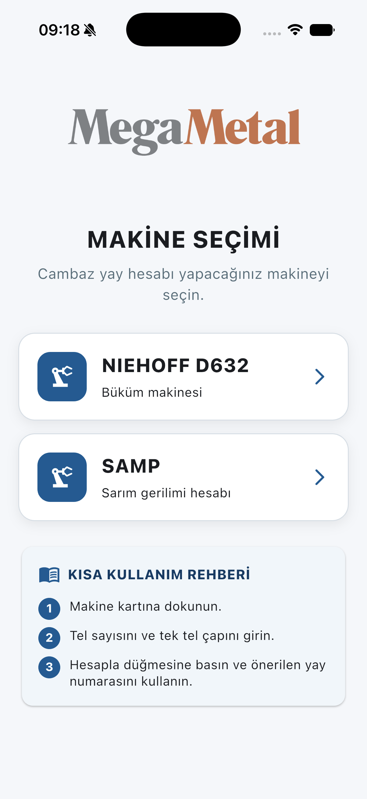
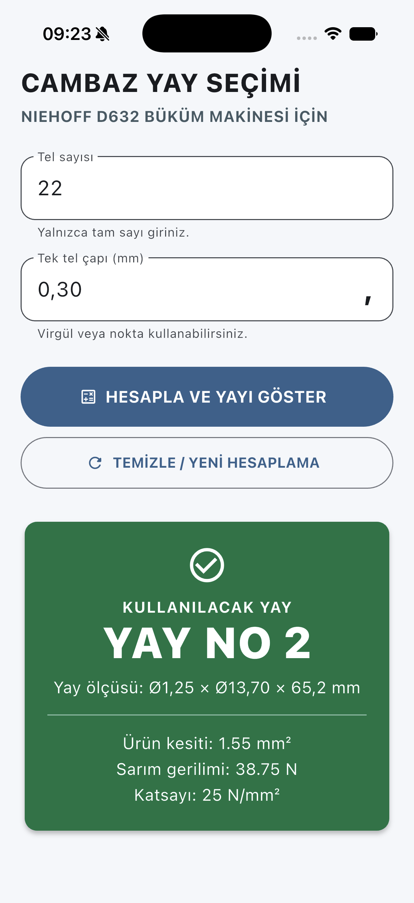

# MegaMetal Spring Selection

An offline mobile application developed during Selhan Coşkun's electrical-electronics engineering internship at Mega Metal in Kayseri. It turns a machine-card calculation into a simple workflow: select the machine, enter the wire count and single-wire diameter, and view the winding tension and, for NIEHOFF D632, the recommended dancer spring.

**Türkçe:** Mega Metal stajı kapsamında geliştirilen cambaz yayı seçimi ve sarım gerilimi hesaplama uygulaması. Operatör yalnızca makineyi, tel sayısını ve tek tel çapını seçer veya girer; hesaplama cihaz üzerinde yapılır.

## Application preview

<p>
  
  
</p>

Screenshots were captured from the project running in the iPhone Simulator.

## Purpose and scope

The project addresses a spring-selection problem observed during the internship: operators could choose an unsuitable dancer spring when interpreting the calculation manually. The application makes the calculation repeatable and displays its result clearly.

| Machine | Output |
| --- | --- |
| NIEHOFF D632 | Conductor cross-section, coefficient, winding tension, spring number and dimensions |
| SAMP | Conductor cross-section, coefficient and winding tension |

The repository contains the software component of the internship. The bobbin scrap and spring replacement-period Kaizen studies are separate activities. This application does not estimate spring fatigue life or establish a replacement interval.

## Features

- Offline calculation without a server or user account.
- Turkish interface with machine selection and a short usage guide.
- Two calculation inputs: wire count and single-wire diameter in millimetres.
- Decimal comma and decimal point support, with automatic input normalization.
- Input filtering and messages for missing or invalid values.
- Large, colour-coded spring results and spring dimensions.
- A warning instead of a spring recommendation outside the defined 4–100 N range.
- Clear/new calculation button, back button and swipe navigation.

## Development history

1. **Python:** the calculation was implemented separately from the user interface and checked with unit tests.
2. **Kivy:** a Python interface prototype connected the inputs to the calculation engine.
3. **Flutter and Dart:** the mobile application was rebuilt with machine selection, validation, navigation and branded assets. The final mobile calculation runs in Dart; it does not call a Python backend.

The mobile application has been run in the iOS Simulator. Android platform files are included, but a completed Android device or emulator validation is not claimed here.

## Calculation method

The implementation follows the machine-card procedure used in this project:

```text
raw cross-section = wire count × single-wire diameter² × 3.14 / 4
cross-section     = floor(raw cross-section × 100) / 100
winding tension   = cross-section × selected coefficient
```

Cross-section is truncated to two decimal places before the tension calculation. The coefficient is selected from the largest reference cross-section that does not exceed the calculated value. Below the first reference, the implementation uses the first coefficient.

| Reference cross-section (mm²) | Coefficient (N/mm²) |
| ---: | ---: |
| 0.09 | 50 |
| 0.14 | 40 |
| 0.35 | 40 |
| 0.80 | 30 |
| 1.50 | 25 |
| 2.50 | 20 |
| 4.00 | 20 |
| 6.00 | 16 |

For NIEHOFF D632, the project uses these non-overlapping selection intervals:

| Winding tension | Spring | Dimensions shown in the application |
| --- | --- | --- |
| 4 ≤ F < 10 N | No. 1 | Ø0.8 × Ø8.80 × 55.5 mm |
| 10 ≤ F < 80 N | No. 2 | Ø1.25 × Ø13.70 × 65.2 mm |
| 80 ≤ F ≤ 100 N | No. 3 | Ø1.60 × Ø12.7 × 68.0 mm |
| F < 4 N or F > 100 N | No recommendation | Consult the responsible engineer |

These values describe this project's configured rules, rather than a general spring-selection specification for all machines. The application provides calculation support and has no connection to a machine controller.

### Worked example

```text
Machine:               NIEHOFF D632
Wire count:            22
Single-wire diameter:  0.30 mm
Cross-section:         1.55 mm²
Coefficient:           25 N/mm²
Winding tension:       38.75 N
Recommended spring:    No. 2
```

For SAMP, the same inputs produce the same cross-section and tension without a spring recommendation.

## Run the Flutter application

Use a Flutter SDK containing Dart 3.9 or later, with the tools required for the target platform. iOS development requires macOS and Xcode; Android development requires the Android SDK.

From the repository root:

```bash
cd mobile
flutter pub get
flutter devices
flutter run
```

If multiple devices are available, use `flutter run -d <device-id>`. The Flutter SDK and local platform SDKs are not included in this repository.

## Run the Python prototype

The calculation engine can be tested with Python 3.10 or later, without installing Kivy:

```bash
python3 -m unittest -v
```

To run the Kivy interface, use a Python version supported by the installed Kivy release. Python 3.12 is a suitable environment for this prototype:

```bash
python3.12 -m venv .venv
source .venv/bin/activate
python -m pip install -r requirements.txt
python app.py
```

On Windows, activate the environment with `.venv\Scripts\activate`.

## Tests

```bash
# Python calculation tests, from the repository root
python3 -m unittest -v

# Flutter calculation and widget tests
cd mobile
flutter pub get
flutter test
```

The Python tests cover the machine-card example, spring interval boundaries, out-of-range results and an invalid input. Flutter tests cover the D632 example, the SAMP calculation and the initial machine-selection screen. These checks verify the listed software behaviours; they do not measure factory scrap reduction or validate a spring's physical service life.

## Repository structure

```text
.
├── calculator.py             # Python calculation engine
├── app.py                    # Kivy interface prototype
├── test_calculator.py        # Python unit tests
├── requirements.txt          # Kivy dependency
├── mobile/
│   ├── lib/main.dart         # Flutter interface and Dart calculation
│   ├── test/                 # Flutter calculation and widget tests
│   ├── assets/               # Application logos and icon source
│   └── ...                   # Flutter platform projects
└── docs/screenshots/         # iOS Simulator screenshots
```

## Academic context and attribution

**Author:** Selhan Coşkun, Electrical-Electronics Engineering, Abdullah Gül University.

Prepared as the source-code companion to the Mega Metal summer internship project. The repository can be linked from the final report's appendix. Daily activity forms, the final report and company presentation files are not included.

Mega Metal branding belongs to its respective owner. This repository documents a student internship project and does not represent an official company software release.
